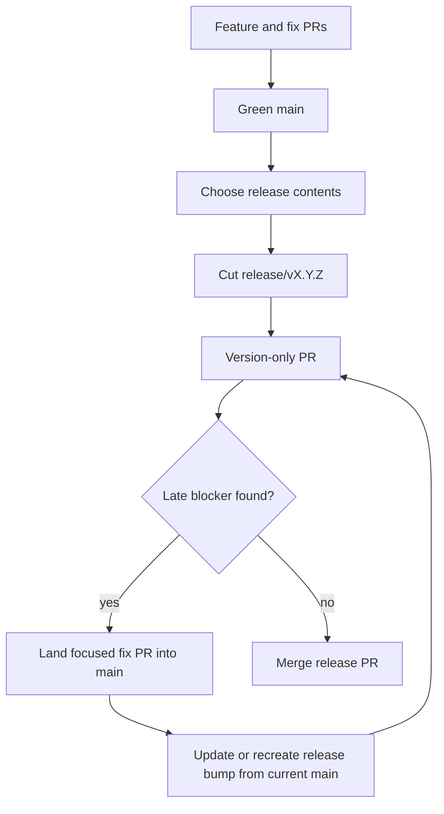
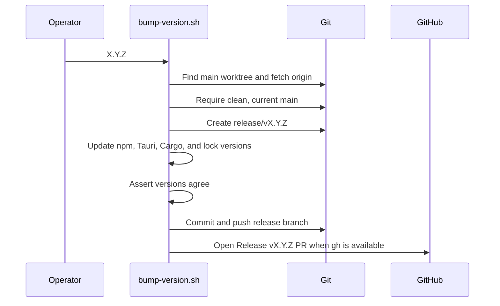
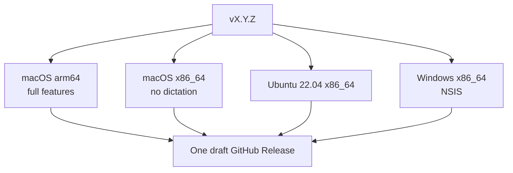
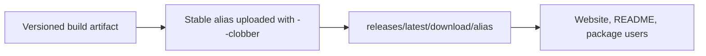

# Release Process

> This is the illustrated release lifecycle. The operator quick reference is
> [RELEASING.md](../RELEASING.md); the implementation lives in
> `scripts/bump-version.sh` and `.github/workflows/release.yml`.

## 1. Release principles

- Releases come from an up-to-date, protected `main` branch.
- The version bump is reviewed in its own pull request.
- The release tag is created on `main` **after** that PR merges.
- A tag triggers native builds on each operating-system runner.
- CI creates a draft GitHub Release; maintainers inspect it before publishing.
- Publishing, not tagging, makes the release current and starts updater rollout.
- Stable installer aliases must not change because the website and README use
  permanent `releases/latest/download/...` URLs.

### Version notation

Canopy deliberately uses both forms. Pass the numeric semantic version without
`v`; Git references and release coordination add `v`:

| Location | Form | Example |
|---|---|---|
| `bump-version.sh` argument | `X.Y.Z` | `./scripts/bump-version.sh 0.4.0` |
| `package.json`, Cargo, Tauri config | `X.Y.Z` | `0.4.0` |
| Release branch | `release/vX.Y.Z` | `release/v0.4.0` |
| Release commit and PR title | `Release vX.Y.Z` | `Release v0.4.0` |
| Git tag and workflow trigger | `vX.Y.Z` | `v0.4.0` |
| GitHub release display name | `Canopy X.Y.Z` | `Canopy 0.4.0` |

Do not pass `v0.4.0` to the script or write `v0.4.0` into version files. The
script validates a numeric `X.Y.Z`, then constructs the branch and tag names.

## 2. End-to-end flow

```mermaid
flowchart LR
  Main[Fresh origin/main]
  Bump[Run bump-version.sh X.Y.Z]
  Branch[release/vX.Y.Z]
  PR[Version bump PR]
  Merge[Merge into main]
  Tag[Run bump-version.sh --tag X.Y.Z]
  CI[Multi-platform release workflow]
  Draft[Draft GitHub Release]
  QA[Artifact and install QA]
  Publish[Publish release]
  Update[Latest links and updater activate]

  Main --> Bump --> Branch --> PR --> Merge --> Tag --> CI --> Draft --> QA --> Publish --> Update
```



The two phases prevent a tag from pointing at a release-branch commit that is
later replaced by a squash merge.

## 3. Phase 0: choose and prepare the version

Before starting:

1. Confirm all intended feature and fix PRs are merged.
2. Review open release blockers and CI on `main`.
3. Choose the semantic version `X.Y.Z`.
4. Confirm no local or remote `vX.Y.Z` tag exists.
5. Confirm required signing and notarization credentials are available.
6. Ensure the main worktree is clean.
7. Prepare user-facing release notes for the draft review.

### Feature freeze and release cut

A release cut is not a feature branch. By the time `release/vX.Y.Z` is created,
all intended feature and fix PRs should already be merged into `main`. The
release branch contains only synchronized version and lockfile changes.



- New features discovered after the cut wait for the next release.
- A release-blocking fix lands through its own normal `fix/...` PR to `main`.
- After a late fix merges, update the release branch from `main` while preserving
  a version-only diff, or close and recreate the release branch if that is
  clearer. Never hide a product fix inside the version-bump commit.
- Do not tag until the release PR includes the intended final `main` state and
  has merged.

Canopy is pre-1.0, but release numbers still communicate scope:

- patch: fixes and compatible refinements;
- minor: new features or meaningful product changes;
- major: reserved for a stable contract or intentionally breaking release.

## 4. Phase 1: version bump pull request

Run:

```sh
./scripts/bump-version.sh X.Y.Z
```

The script:



The release PR must contain only the version bump and lockfile consequences.
Review its file list and version agreement, let CI complete, then merge it using
the normal [pull request etiquette](./pull-request-etiquette.md).

## 5. Phase 2: tag merged main

After the release PR merges:

```sh
./scripts/bump-version.sh --tag X.Y.Z
```

The script checks that:

- the tag does not already exist locally or remotely;
- `main` is fast-forwarded from origin;
- `package.json`, `src-tauri/Cargo.toml`, and
  `src-tauri/tauri.conf.json` all equal `X.Y.Z`.

It then creates and pushes `vX.Y.Z`. Do not create the tag on the release branch
or move an existing release tag to another commit.

## 6. CI build matrix

The pushed tag triggers `.github/workflows/release.yml`.



| Target | Primary artifacts | Update behavior |
|---|---|---|
| macOS Apple Silicon | `.dmg`, app updater archive and signature | in-app updater |
| macOS Intel | `.dmg`, updater archive and signature; dictation disabled | in-app updater |
| Linux x86_64 | AppImage, `.deb`, `.rpm`, updater signature | AppImage in-app; packages via package manager |
| Windows x86_64 | NSIS setup executable and updater artifacts | in-app updater; currently unsigned |

Each runner installs dependencies, builds the sidecar and portal through the
Tauri build hooks, stages the matching ONNX Runtime when dictation is enabled,
and uploads assets into the same draft release.

## 7. Signing and secrets

The workflow depends on repository secrets for:

- Tauri updater private key and password;
- Apple signing certificate, certificate password, identity, account,
  app-specific password, and team ID.

Secret values never belong in the repository, Wiki, logs, issue, or pull request.
The updater public key is compiled into the application. Losing the private key
would prevent already-installed copies from accepting future updates, so it
must be backed up securely outside the repository.

The workflow explicitly verifies updater `.sig` files because a Tauri build can
exit successfully even when updater signing failed.

## 8. Stable download aliases

The release includes version-independent aliases:

```text
Canopy-macos-arm64.dmg
Canopy-macos-intel.dmg
Canopy-linux-x86_64.AppImage
Canopy-linux-x86_64.deb
Canopy-linux-x86_64.rpm
Canopy-windows-x86_64-setup.exe
```



### Standalone Canopy Terminal (beta)

The release also carries the native terminal as its own download, usable without
the IDE (macOS Apple silicon and Linux x86_64 only; Windows has no host launch
yet, and Intel Macs get it only inside the IDE):

```text
Canopy-Terminal-macos-arm64.zip           Canopy Terminal.app, signed + notarized + stapled
Canopy-Terminal-macos-arm64.zip.sha256
Canopy-Terminal-linux-x86_64.tar.gz       canopy-term-app, canopy-pty-host, README.txt, LICENSE.md
Canopy-Terminal-linux-x86_64.tar.gz.sha256
```

They are built in the `build` matrix jobs by `scripts/package-term-app.mjs` from
the binaries `prepare-sidecar.mjs` already built, so they are the same build as
the one bundled in the IDE. They are uploaded to the draft only for tags (never
by a manual run), and `scripts/release-assets.mjs` requires all four, with a
digest, before `finalize` can pass; a `.sha256` must also hold the digest of the
asset it names. They are not updater payloads: nothing about them reaches
`latest.json`, and the standalone has no updater (users download again).

The macOS app is `Canopy Terminal.app`, bundle id `app.causeconnect.canopy.terminal`
(the IDE's id plus `.terminal`), signed with the same Developer ID as the IDE:
hardened runtime, secure timestamp and no entitlements on either program
(`src-tauri/term-app-entitlements.plist`, `src-tauri/pty-host-entitlements.plist`),
then notarized with `notarytool` and stapled. A tag build fails if it cannot sign
and notarize. After packaging, CI unpacks the zip and checks `codesign --verify
--strict`, hardened runtime, timestamp, Developer ID, zero entitlements,
`stapler validate`, and that `spctl --assess` reports `Notarized Developer ID`.

How it finds its host: `canopy-term-app` installs the `canopy-pty-host` beside
it into `~/.canopy/pty-host/term-app-bin/<version>-<digest>/` and starts the host
from there (never from Downloads or a bundle an update replaces). It shares
`~/.canopy/pty-host/host.sock` with the IDE only when the host that is already
running was started by the same app version (read from the host's path). An idle
host of another version is stopped and replaced; one that still runs terminals is
left alone and the app prints which Canopy started it and what to do.

Changing an alias breaks published download links. Update the workflow, README,
and website together if a rename is ever unavoidable.

## 9. Draft release QA

Do not publish immediately after CI turns green. Review the draft as a release
candidate.

### Asset checks

- [ ] Every matrix target completed or has an understood blocker.
- [ ] Expected installers and updater archives exist.
- [ ] Updater `.sig` files exist.
- [ ] `latest.json` exists and points at the intended version.
- [ ] Every stable-name alias exists, including the four standalone Canopy Terminal assets.
- [ ] Standalone Canopy Terminal manual test done (see below).
- [ ] Release title, tag, version, and notes agree.
- [ ] No logs or assets expose credentials.

### Installation checks

- [ ] Install and launch the Apple Silicon DMG.
- [ ] Verify macOS signature, notarization, and Gatekeeper behavior.
- [ ] Smoke-test Intel macOS behavior when available, including no dictation.
- [ ] Launch the Linux AppImage on a compatible x86_64 system.
- [ ] Install at least one package-manager artifact when release risk warrants it.
- [ ] Install and launch the Windows NSIS artifact; confirm the documented
      SmartScreen warning while it remains unsigned.
- [ ] Confirm the version in About and updater metadata.
- [ ] Smoke-test a terminal, agent launch, project open, and update check.

### Documentation checks

- [ ] README platform links resolve to the expected stable aliases.
- [ ] Website download links match the aliases.
- [ ] GitHub release notes describe user-visible changes and limitations.
- [ ] Security or migration notes are prominent when needed.

## 10. Publish and observe

Publishing the draft:

- makes it the latest public release;
- activates stable `releases/latest/download/...` links;
- exposes `latest.json` to installed copies;
- begins in-app update availability.

After publishing:

1. Verify the public release page and all stable download links.
2. Check one installed copy can discover the update.
3. Monitor new issues, Discussions, and update failures.
4. Keep GitHub Releases as the canonical changelog.
5. Do not rewrite or move the published tag.

## 11. Dry runs and local macOS releases

Run the GitHub workflow manually with `workflow_dispatch` to exercise the build
matrix without a release tag. With no tag, upload steps are skipped.

Release builds on macOS and Linux build `canopy-term-app` and need Zig 0.15.x
(`release.yml` installs the pinned 0.15.2; `scripts/release-macos.sh` requires it
on PATH). Windows does not bundle it.

To prove only that the terminal app (`canopy-term-app` and `canopy-pty-host`)
builds for macOS arm64, macOS Intel (cross) and Linux, tick `term_app_dry_run`:
the release jobs are skipped and only `term-app-dry-run` runs, with the pinned
Zig from `.github/actions/install-zig`. It needs no secrets, signs nothing and
creates no tag, draft or upload.

To prove the standalone downloads package correctly without a release, tick
`term_app_standalone_dry_run`: only `term-app-standalone-dry-run` runs (macOS
arm64 and Linux), with no secrets. It builds both programs, packages both assets
UNSIGNED and not notarized (the job log and summary say so), checks the layout,
the checksums and that the packaged programs start, prints the sizes and keeps
the files as an artifact for 7 days. It does not exercise signing, notarization,
stapling or Gatekeeper; only a real signed run on a tag (or a manual run of the
whole workflow with the secrets) does.

For a local signed macOS build:

```sh
./scripts/release-macos.sh aarch64
./scripts/release-macos.sh x86_64
./scripts/release-macos.sh both
```

The script preflights signing, updater key, and notarization before building,
then signs, notarizes, staples, and runs Gatekeeper assessment.

## 12. Failure and rollback etiquette

- If CI fails transiently and the tagged commit is correct, rerun failed jobs.
- If code or version metadata is wrong, fix it through a pull request and cut a
  new patch version. Do not move a public tag to a different commit.
- Never publish an incomplete draft to “fix later.” Installed copies trust the
  published updater metadata.
- If a bad release is published, stop promotion, document impact, fix forward in
  a new patch release, and use the Security Policy for sensitive incidents.
- Package-manager rollback and updater behavior differ by platform; describe
  any required user action in the release notes.

## 13. Release checklist

- [ ] Intended changes merged and `main` CI green.
- [ ] Version selected and release notes prepared.
- [ ] Phase 1 version-bump PR created, reviewed, green, and merged.
- [ ] Phase 2 tag created from updated `main`.
- [ ] All platform builds completed.
- [ ] Signatures, updater JSON, installers, and stable aliases verified.
- [ ] Platform smoke checks completed or gaps documented.
- [ ] Draft release notes and limitations reviewed.
- [ ] Draft published deliberately.
- [ ] Public downloads and updater checked after publication.

## Manual test: standalone Canopy Terminal (macOS)

CI cannot prove the Gatekeeper first launch. Before publishing, on a clean Mac
(or a user account that has never opened Canopy), with Apple silicon:

1. Download `Canopy-Terminal-macos-arm64.zip` from the **draft** release in a
   browser (so it is quarantined; `curl` does not set the flag). Check the
   checksum: `shasum -a 256 -c Canopy-Terminal-macos-arm64.zip.sha256`.
2. Unzip it by double-click. Run:
   - `spctl --assess --type execute --verbose=4 "Canopy Terminal.app"` and expect
     `accepted` with `source=Notarized Developer ID`.
   - `xcrun stapler validate "Canopy Terminal.app"` and expect
     `The validate action worked!`.
   - `codesign -dvvv "Canopy Terminal.app/Contents/MacOS/canopy-term-app"`:
     `flags=0x10000(runtime)`, a `Timestamp=`, `Authority=Developer ID Application`.
3. Double-click it. Expect no malware or "cannot verify" dialog (macOS may show
   the one-time "downloaded from the internet, Open?" prompt), a window with a
   shell in your home directory, the Canopy Terminal name and icon in the Dock.
4. Close the window, reopen: the session is still there (the host keeps it).
   `~/.canopy/pty-host/term-app-bin/` holds the installed host.
5. With the IDE of the **same** version running its hosted terminals, open the
   terminal: it shares the host. With an IDE of a **different** version holding
   terminals, it must refuse with the message naming that version.
6. Report what step 2 printed.

Linux: `tar -xzf Canopy-Terminal-linux-x86_64.tar.gz`, then
`./canopy-term-app` on a desktop with Vulkan or OpenGL; this has not been run on
a real display by CI.
